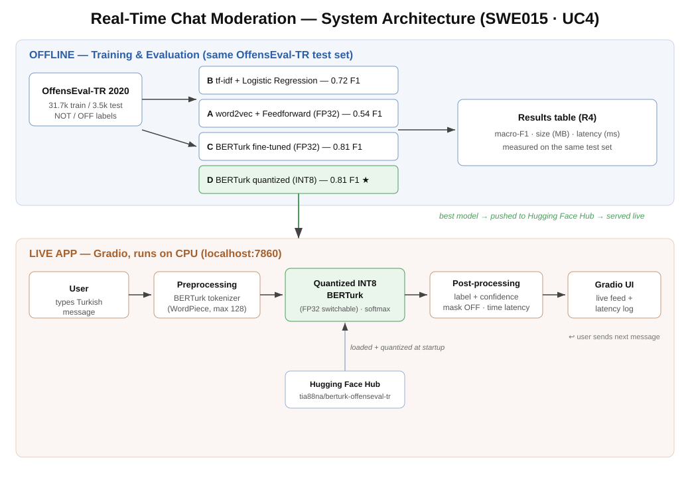

# 🛡️ Real-Time Turkish Chat Moderation


An intelligent application that flags **offensive Turkish chat messages in real time**
on a CPU-only budget. Every message is classified as *clean* or *offensive* with a
confidence score, offensive messages are **masked**, and the per-message response time
(latency) is logged live.

The same task is solved with **four models of increasing sophistication** — a classical
baseline, a neural network trained from scratch, a Transformer, and a quantized
Transformer — all evaluated on the **same** held-out test set and compared on accuracy,
size and speed. The quantized Transformer powers the live application.

> SWE015 — Introduction to Large Language Models · Use Case 4 (Real-Time Chat Moderation)

---

## ✨ Features

- **Live chat moderation UI** (Gradio) — type a message, get an instant verdict.
- **Confidence score** for every prediction.
- **Automatic masking** of offensive messages (`⟨hidden⟩`).
- **Latency panel** — logs the response time of every message.
- **Model switch** — compare the quantized (INT8) model against FP32 at runtime.
- **Evasion-resistant preprocessing** — Turkish-aware lowercasing, leetspeak and
  stretched-letter normalization before inference.

---

## 🧠 The model ladder

| # | Model | Technique area | What it does |
|---|-------|:--------------:|--------------|
| 1 | tf-idf + Logistic Regression | **B** — Classical NLP | Classical baseline over normalized text |
| 2 | word2vec + Feedforward network | **A** — Deep learning | Own word2vec, averaged embeddings → FFN (SGD) |
| 3 | BERTurk (fine-tuned) | **C** — Transformers | `dbmdz/bert-base-turkish-cased` fine-tuned |
| 4 | **BERTurk INT8 (quantized)** | **D** — Efficient models | Dynamic INT8 quantization — **runs in the app** |

---

## 📊 Results

All models evaluated on the **same OffensEval-TR 2020 test set** (3 528 messages),
measured on CPU. Metric: **macro-F1** (the classes are imbalanced).

| Model | Macro-F1 | Size | Latency |
|-------|:--------:|:----:|:-------:|
| tf-idf + Logistic Regression (B) | 0.7246 | 1.77 MB | 0.50 ms/msg |
| word2vec + Feedforward (A) | 0.5432 | 25.5 MB | 0.27 ms/msg |
| BERTurk FP32 (C) | **0.8120** | 443 MB | 42.0 ms/msg |
| BERTurk INT8 (D) | 0.8056 | 186 MB | 38.9 ms/msg |

**Takeaways**
- **BERTurk** clearly wins on accuracy, but it is the largest and slowest model.
- **INT8 quantization** keeps almost the same accuracy (0.8120 → 0.8056) while cutting
  the size ~2.4× — the best accuracy/footprint trade-off for deployment.
- The **word2vec + FFN** model *underperforms* the tf-idf baseline. Averaging word
  embeddings discards word order, and a small corpus yields weak embeddings — a reminder
  that a neural model is not automatically better than a classical one.

---

## 🏗️ Architecture



Data flows from the user's message → Turkish-aware normalization → BERTurk tokenizer →
the quantized INT8 BERTurk → post-processing (label, confidence, masking, latency) →
the Gradio UI. The model is loaded from the Hugging Face Hub and quantized at startup.

---

## 📁 Project structure

```
chat-moderation/
├── app.py                     # Gradio real-time moderation app (runs INT8 BERTurk)
├── baseline_standalone.py     # Area B — tf-idf + Logistic Regression
├── model_a_standalone.py      # Area A — own word2vec + feedforward network
├── quantize_standalone.py     # Area D — dynamic INT8 quantization + comparison
├── c_berturk_finetune.ipynb   # Area C — BERTurk fine-tuning (Google Colab, GPU)
├── architecture.svg           # System architecture diagram
├── requirements.txt
└── README.md
```

---

## 🚀 Setup

```bash
pip install torch transformers scikit-learn gensim gradio
```

> The scripts download the OffensEval-TR train/test splits directly, so the `datasets`
> library is **not** required.

---

## ▶️ Usage

### Run the live application
```bash
python app.py
```
Then open the URL it prints (`http://127.0.0.1:7860`). On first run it downloads the
fine-tuned model from the Hugging Face Hub and quantizes it.

### Reproduce the results
```bash
python baseline_standalone.py      # Area B — classical baseline
python model_a_standalone.py       # Area A — word2vec + feedforward
python quantize_standalone.py      # Area D — quantize BERTurk (needs ./berturk-offenseval)
```

### Fine-tune BERTurk (Area C)
Open `c_berturk_finetune.ipynb` in **Google Colab** with a GPU runtime and run all cells.

---

## 📦 Dataset & model

- **Dataset:** [OffensEval-TR 2020](https://huggingface.co/datasets/stefan-it/offenseval2020_tr)
  — 31 756 training / 3 528 test Turkish tweets, labeled `NOT` / `OFF`.
- **Fine-tuned model:** **https://huggingface.co/tia88na/berturk-offenseval-tr**
  (not committed here — see `.gitignore`; download it for `quantize_standalone.py` and `app.py`).

---

## ⚠️ Limitations

- The model is **case-sensitive** (BERTurk cased, trained on mostly lowercase tweets).
  The app mitigates this with normalization, but heavily disguised insults
  (e.g. deliberate misspellings) can still slip through.
- The task is **offensive vs. clean**, not spam detection — random/gibberish text is
  correctly labeled *clean* because it is not offensive.
- The `OFF` (minority) class is harder (F1 ≈ 0.70 for BERTurk) due to class imbalance.

---

## 🤖 AI usage

An AI coding assistant was used for scaffolding, debugging, and data-loading fixes.
Every reported number comes from our own runs. See the AI Usage slide for details.

---

## 📄 License

MIT
